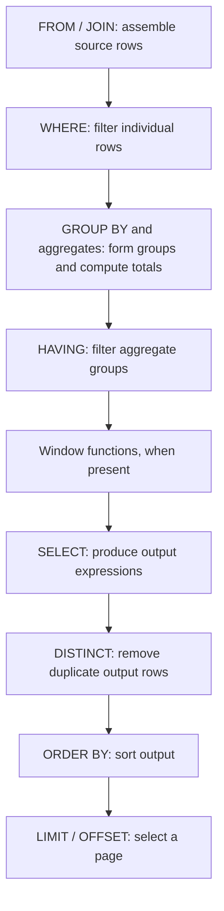
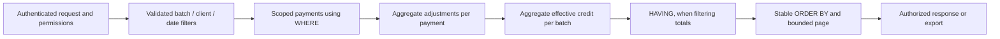

# 55 — SQL Execution Order & Index Design

The database is PostgreSQL. Prisma owns the schema and committed SQL migrations in
`apps/api-ts/prisma/`. NestJS guards and query scopes enforce access before data is returned.
This design applies to payment lists, Finance balances, collections and reconciliation.

## Logical execution order

For an ordinary SELECT, reason about the result in this order:



This is the logical model, not a promise of physical execution order. PostgreSQL may reorder
joins, push predicates down, inline CTEs or use an index to avoid sorting. Each CTE/subquery
has its own logical processing; set operations combine those results before their final
ordering and pagination. See the [PostgreSQL SELECT documentation](https://www.postgresql.org/docs/current/sql-select.html).

## Row filters belong in WHERE; aggregate filters belong in HAVING

The teaching example places an ordinary department condition in HAVING:

```sql
SELECT Department, SUM(Amount) AS TotalSales
FROM Sales
GROUP BY Department
HAVING Department = 'Electronics' AND SUM(Amount) > 10000;
```

Prefer this explicit separation:

```sql
SELECT Department, SUM(Amount) AS TotalSales
FROM Sales
WHERE Department = 'Electronics'
GROUP BY Department
HAVING SUM(Amount) > 10000;
```

Department is a row-level predicate; the total is known only after aggregation. PostgreSQL
can push a safe grouping-key HAVING predicate down, so these two queries can have identical
plans. Do not label one universally slow and the other fast. Compare actual plans on the
same data. Do not move aggregate predicates into WHERE or change outer-join semantics.

## Finance report query design

Use this sequence for a scoped financial read:



For example, a verified-credit report includes Finance adjustments without multiplying
the original amount by the number of adjustment rows:

```sql
WITH scoped_payments AS (
    SELECT id, "batchId", amount
    FROM "Payment"
    WHERE status = 'VERIFIED'
      AND "batchId" = $1::uuid
      AND "paymentDate" >= $2::date
      AND "paymentDate" <= $3::date
), credits AS (
    SELECT p.id, p."batchId", p.amount + COALESCE(SUM(a.amount), 0) AS credit
    FROM scoped_payments p
    LEFT JOIN "PaymentAdjustment" a ON a."paymentId" = p.id
    GROUP BY p.id, p."batchId", p.amount
)
SELECT "batchId", SUM(credit) AS "verifiedCredit"
FROM credits
GROUP BY "batchId"
HAVING SUM(credit) > $4::numeric
ORDER BY "batchId";
```

Values stay bound parameters. Include the caller's record scope in the source predicates;
an example query does not grant permissions. A client-scoped read must constrain client ID.

## Preserve the financial meaning of each filter

- **Collections:** batch scope means the client's current batch. Filter relevant clients
  before joining schedules/payments. Only VERIFIED and PENDING payments contribute to its
  aggregates. Adjustment aggregation needs only scoped VERIFIED payments.
- **Lifetime balances:** keep all verified historical credits and issued schedule amounts.
  A report date range filters period figures, not the customer's lifetime balance. The
  existing aggregate FILTER clauses express this distinction.
- **Reconciliation:** batch scope means the payment's recorded batch. Apply batch/date
  predicates in `scoped_payments` before adjustment audit checks and aggregation.
- **Duplicate-reference evidence:** compare against the entire ledger. A duplicate outside
  the selected batch or date range must still flag the scoped payment. The global reference
  CTE deliberately retains that wider scope.
- **Pagination:** compute whole-scope totals before taking a page. LIMIT on source rows
  would truncate report totals. Detail pages order by createdAt and ID to resolve ties.
- **Money:** use numeric/decimal types; verification is Finance-only and audited. A query
  optimization must preserve adjustments, authorization, missing records and null handling.

Implementation: `src/reports/collections.ts`, `src/reports/reconciliation.ts`,
`src/finance/finance.service.ts` and `src/finance/ledger.ts` under `apps/api-ts/`.

## Index migration

Migration: `20261013010000_finance_query_indexes`.

| B-tree columns on Payment | Query supported |
|---|---|
| createdAt, id | Latest payments, ordered by createdAt DESC and id DESC |
| clientId, status, createdAt, id | Customer verified history and pending-payment previews |
| status, createdAt, id | Status-filtered payment queues with stable pagination |
| batchId, paymentDate, id | Recorded-batch and inclusive date-range reports |
| status, paymentDate, id | Status and date-range counts/amount aggregates |

The migration creates the replacements before removing the shorter clientId/status and
status/createdAt indexes. Those prefixes remain covered. Existing batch/status,
status/updatedAt/ID and paymentDate indexes remain for their different access patterns.
Primary keys, unique constraints and adjustment payment-ID indexes remain intact.

Put equality columns first, followed by range or ordering columns appropriate to the query.
An index after a range column may help less than expected; column order must match the real
predicate. An ascending B-tree can satisfy the all-descending ordering above with a backward
scan. Do not add an index for every column: each index costs storage and write work.
See [multicolumn indexes](https://www.postgresql.org/docs/current/indexes-multicolumn.html)
and [indexes and ordering](https://www.postgresql.org/docs/current/indexes-ordering.html).

These B-tree indexes do not make arbitrary contains searches (`ILIKE '%text%'`) fast.
Assess a dedicated trigram/full-text design against search plans and workload separately.
Large OFFSET values also require skipping earlier results; consider cursor pagination if
deep-page usage warrants changing the API contract.

## Verification and measured evidence

Use `EXPLAIN (ANALYZE, BUFFERS, FORMAT JSON)` on SELECT queries with representative data.
Inspect source rows, rows removed by filters, scan type, sort nodes, estimated versus actual
rows, buffer reads and execution time. A sequential scan on a small table or a broad report
can be the correct plan; never force index scans to manufacture a good result.

The [synthetic plan capture](evidence/2026-10-13-finance-index-plans.json) uses 100,000 payment
rows in a temporary table, representative old indexes and the new replacements. Each query
was warmed before capture; all temporary fixtures were rolled back. This isolates index
access patterns, not the complete API or production workload.

| Synthetic query | Before | After | Plan change |
|---|---:|---:|---|
| Latest 20 payments | 81.854 ms | 0.033 ms | Scan 100,000 rows and sort → index scan returning 20 |
| Customer verified history | 0.277 ms | 0.070 ms | Bitmap scan and sort → ordered index scan |
| Batch/date amount total | 0.300 ms | 0.051 ms | Combine two bitmap indexes → batch/date composite index |
| Status/date amount total | 0.658 ms | 0.606 ms | Date index → status/date index; modest timing benefit here |

These are single local synthetic measurements, not latency promises. Retest with realistic
volumes, distribution, concurrent writes and production hardware. Run ANALYZE after bulk
imports so the planner has representative statistics.

## Migration and review checklist

1. Identify the concrete WHERE/JOIN/ORDER BY pattern and inspect existing indexes.
2. Keep row predicates in WHERE and total predicates in HAVING; preserve business scope.
3. Add a new committed migration and matching Prisma index declarations. Leave applied
   historical migrations unchanged.
4. Apply migrations to a dedicated `_test` database and compare schema/index definitions.
5. Run report, reconciliation and adjustment integration checks, including authorization,
   cross-period duplicate evidence and full-lifetime balances.
6. Capture representative EXPLAIN plans and verify benefit before release.
7. For a large live table, plan index creation around write traffic. The current ordinary
   CREATE INDEX statements can block writes during construction. Assess a separately
   rehearsed concurrent-index deployment when needed; production has not been modified.

See the [PostgreSQL EXPLAIN guide](https://www.postgresql.org/docs/current/using-explain.html)
and [CREATE INDEX documentation](https://www.postgresql.org/docs/current/sql-createindex.html).
