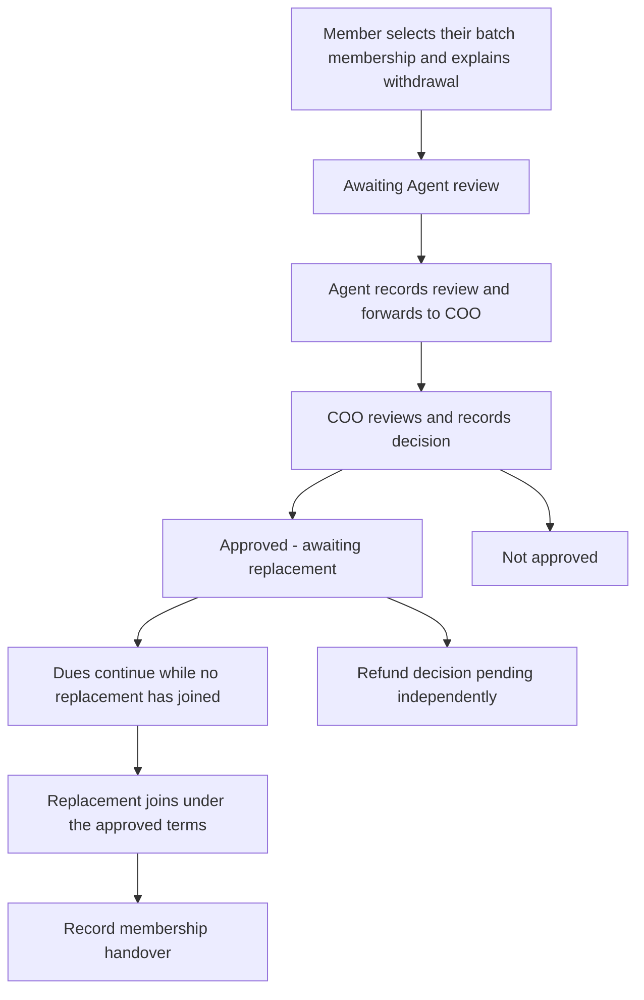

# Member withdrawal, discretionary refund and replacement review

**Status: implemented and verified in the main local demo — October 30, 2026.**
See the [implemented workflow and verification](77-member-withdrawals-main-demo.md).
The planning discussion below is retained as dated requirements/proposals; the
implementation guide records the resulting configured behavior. October 26 checklist
item **#3**, with replacement-policy dependencies on #4 and the separate #5
capacity implementation. Updated October 30, 2026 from Jaycee's instructions and
answers in the calendar/numbering integration conversation.

## Business rules from Jaycee

1. A member submits a form explaining the context/reason for withdrawing.
2. The Agent reviews that request and forwards it to the COO for another review
   before a decision. Agent review is not final withdrawal approval.
3. Withdrawal approval and refund resolution are separate: the COO may approve
   withdrawal while the refund amount and payment date remain pending.
4. Refund amounts are discretionary and depend on the business's financial
   position. No fixed amount, percentage, eligibility formula or payment deadline
   has been supplied. An unknown amount must remain unknown, rather than zero.
5. **Dues continue until a replacement joins**, including after withdrawal
   approval. Approval alone does not stop installments or imply a refund was paid.
6. A replacement can continue the unpaid installments or start a new installment
   plan from the beginning. This is chosen for the case, rather than a global
   automatic rule.
7. Jaycee's working direction is for the COO to choose the replacement treatment
   after discussing it with the CEO. This records the business consultation;
   it is not authorization to expand the current report-only CEO account's
   permissions or create a separate in-app CEO approval stage.

The COO/CEO direction was phrased by Jaycee as “I think”; preserve it as the
working direction rather than an independently confirmed company-wide policy.

## Proposed workflow and visible states

These state names and UI details are implementation proposals, not additional
business-policy decisions.

The member form should identify the selected membership/batch, explain the reason
and show the consequences in plain language. One shared customer account may have
multiple memberships; a request must identify the specific membership. Other
memberships and the customer's login remain distinct.

The Agent queue should show only currently assigned requests. Forwarding records
review notes, reviewer and time. The COO queue should show the original request,
Agent review, current membership/financial facts and prior decisions. Versioned
decisions and append-only history are recommended, consistent with existing
enrollment and GCash reviews. Clarification, member cancellation/resubmission,
reopening and exceptional reassignment behavior still need explicit transition
definitions during implementation; they are not inferred approval powers.

The approved case must visibly say **Awaiting replacement — installments continue**.
It must not display a completed withdrawal or remove a capacity position solely
because a request was approved. Replacing a person is a separate recorded event.

## Separate refund tracking

Recommended states are **Decision pending**, **Amount approved / payment pending**,
**Paid**, and **Not approved**, with the actual allowed transitions specified
before implementation. A refund can stay undecided after withdrawal approval or
replacement. A human-entered approved amount must not be auto-calculated from
paid installments, account balance, scheduled earnings or an estimate of the
business's cash position.

Approval is not payment. Do not create negative payments, reuse verified-payment
adjustments as a refund payout, or mark a refund paid without an independently
authorized record of the external payment. The precise refund-amount approver,
payout recorder/verification permissions, evidence and partial-payment handling
have not been fully specified. Existing Finance-only payment verification remains.

## Replacement decision and financial cutover

Record the case's chosen mode and the COO's consultation/decision notes:

| Mode                         | Business direction                                     | Terms required for execution                                                     |
| ---------------------------- | ------------------------------------------------------ | -------------------------------------------------------------------------------- |
| Continue unpaid installments | New member continues the remaining unpaid installments | Exact selected installments, due dates, remaining amounts and effective handover |
| Start a new plan             | New member starts installments from the beginning      | Approved price, installment count, first due date and frequency/alignment        |

Keep separate old/new membership identities and retained historical payments.
The user's instruction does not authorize crediting another person's payments
to the new member, deleting unpaid historical rows or silently replacing the
batch-wide plan. How arrears at handover are attributed and how active versus
historical obligations appear in reports must be explicit before cutover code.

Recommended definition of “joins” is the successful approved replacement
enrollment, rather than a pending request or a typed name. This technical
definition is proposed, not an additional user-confirmed rule. Coordinate the
handover with the #5 capacity owner: the departing member occupies a real place
until replacement; accepting the replacement and releasing that place must be
atomic. Preserve existing assigned-Manager enrollment controls unless explicitly
changed. Do not bypass capacity or grant the Agent enrollment approval.

## Source reconnaissance and reuse recommendation

Reviewed the current portal form, membership selection, assignment scopes,
enrollment reviews/alerts and Finance adjustment boundary. The source currently
has no withdrawal case or replacement model. `ClientStatus` is ACTIVE, ON_HOLD or
COMPLETED; ON_HOLD must not be silently reinterpreted as withdrawal.

| Option inspected                                                                                                                                                                                                 | Useful pattern                                                                                                         | Fit and reuse cost                                                                                             |
| ---------------------------------------------------------------------------------------------------------------------------------------------------------------------------------------------------------------- | ---------------------------------------------------------------------------------------------------------------------- | -------------------------------------------------------------------------------------------------------------- |
| Existing Fresh Phones NestJS/Prisma reviews                                                                                                                                                                      | Current-assignment checks, idempotent submission, version conflicts, audit entries and scoped notifications            | Best fit; add a withdrawal-specific module and permission keys while reusing established infrastructure        |
| [Frappe workflow source](https://github.com/frappe/frappe/blob/develop/frappe/model/workflow.py) and [workflow documentation](https://docs.frappe.io/erpnext/workflows)                                          | Role/state transition checks, current-document reload and approval access checks                                       | Useful design reference; adopting its Python/framework runtime would require a platform migration              |
| [pretix order service source](https://github.com/pretix/pretix/blob/master/src/pretix/base/services/orders.py) and [cancellation-request documentation](https://pretix.eu/about/en/blog/20200325-cancellations/) | Requested cancellation is distinct from refund execution; cancellation and refund attempts have separate service paths | Useful separation pattern; Django/order/payment-provider assumptions do not match this operational records app |

Recommendation: extend the existing NestJS/Prisma patterns with a small explicit
withdrawal case workflow. Reuse infrastructure and design lessons rather than
copying another platform's source or introducing an automatic refund engine.
The GitHub/source comparison was completed before implementation, following
Jaycee's saved research preference.

## Implementation and verification checklist

- [x] Capture member → Agent → COO review and separate refund decision.
- [x] Capture dues-until-replacement and both replacement directions.
- [x] Inspect existing source and compare open-source patterns.
- [ ] Define transitions, data contract and per-role actions without expanding CEO powers.
- [ ] Implement membership-scoped member form, Agent queue and COO decision view.
- [ ] Implement explicit refund tracking under the approved money/access rules.
- [ ] Specify exact replacement terms and report/ledger treatment, then integrate atomic handover with #4/#5.
- [ ] Verify cross-member/Agent isolation, stale writes, duplicate requests and audit history.
- [ ] Verify approval leaves dues running until actual handover and never creates a refund payment.
- [ ] Verify both replacement modes, preserved financial history and current capacity/approval guards.
- [ ] Integrate into the main demo, test normal seeded accounts and update the same afternoon handoff.
- [ ] Jaycee/client tests and accepts.

This planning update does not change application code, account permissions,
financial records or the running demo.
